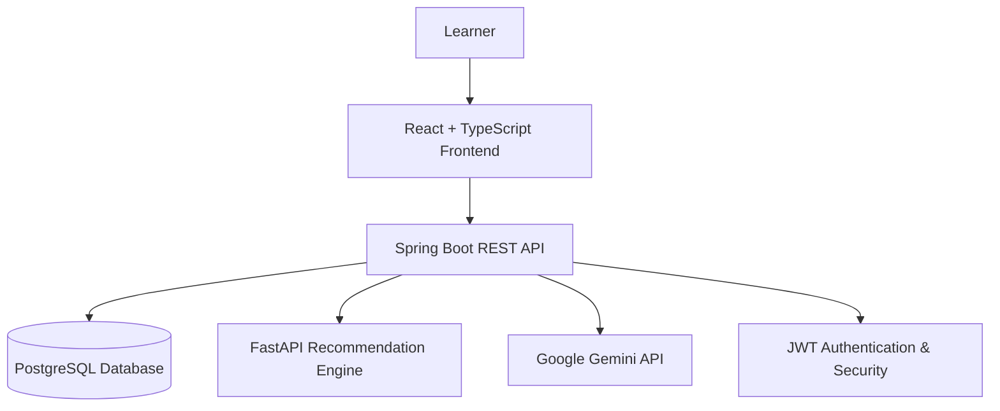

# LearnPath – AI-Powered Personalized Learning & Career Guidance Platform

**LearnPath** is a full-stack, AI-driven learning and career guidance platform designed to help engineering students identify skill gaps, discover relevant learning opportunities, build personalized learning roadmaps, and prepare for their desired career paths.

It combines learner assessments, skill tracking, recommendation services, career intelligence, and generative AI mentorship to provide a more personalized learning experience.

---

## Overview

Traditional learning platforms often provide the same learning paths to everyone, regardless of their existing knowledge, skills, interests, or career goals.

LearnPath aims to address this challenge by bringing multiple learning and career-oriented capabilities into one platform.

The system brings together:

- User profiling and authentication
- Personality and aptitude assessments
- Skill proficiency tracking
- Personalized learning roadmaps
- Course discovery and learning progress
- AI-powered mentorship using Google Gemini
- Career and placement guidance
- Recommendation and analytics services

The goal is to help learners understand where they currently stand, identify what they need to improve, and make informed decisions about their learning and career development.

## Key Features

### 1. Authentication and User Management
- User registration and login
- JWT-based authentication
- Protected application routes
- Secure password hashing
- User profile and session management

### 2. Personalized Dashboard
- Centralized learning dashboard
- Learning progress and activity information
- Skill proficiency views
- Readiness and learning insights
- Recommended learning actions

### 3. Assessment System
- Personality assessments
- Aptitude assessments
- Assessment sessions and answer submission
- Assessment evaluation and results
- Assessment-based learner profiling

Assessment information contributes to the learner's profile and provides input for personalized learning guidance.

### 4. AI-Powered Learning Roadmaps
- Domain-specific learning paths
- Roadmap milestones and learning nodes
- Progress tracking
- Node completion
- Recommended next learning steps

### 5. AI Mentor
Integrated with Google's Gemini API, the AI Mentor provides conversational learning and career guidance.

Capabilities include:
- AI-powered question answering
- Learning and career-related assistance
- Conversation management
- Persistent conversation history
- Message storage
- AI context and usage tracking

### 6. Course Management
- Course catalog
- Course details
- Course workspace
- Lesson navigation
- Learning progress tracking
- Lesson completion

### 7. Recommendation Engine
LearnPath includes a dedicated FastAPI recommendation service.

The recommendation layer exposes endpoints for:

- Full recommendations
- Skill recommendations
- Career recommendations

The recommendation architecture is designed to combine learner information, skill profiles, career interests, and learning data to generate relevant recommendations.

The broader system design incorporates content-based and collaborative recommendation approaches.

### 8. Career and Placement Guidance
- Career-oriented insights
- Skill-gap identification
- Placement readiness information
- Company and role preparation
- Interview preparation guidance

### 9. Analytics and Learning Intelligence
- Learning activity information
- Skill proficiency insights
- Progress tracking
- Dashboard analytics
- Readiness-related information
- Frontend intelligence synchronization with backend dashboard data

---

## Technology Stack

| Layer | Technologies |
|---|---|
| Frontend | React, TypeScript, Vite |
| UI | Tailwind CSS, shadcn-style components, Framer Motion |
| Routing | React Router |
| State Management | Zustand |
| Data Fetching | TanStack Query |
| Backend | Java 17, Spring Boot 3.2.5 |
| Backend Security | Spring Security, JWT |
| Backend APIs | REST APIs |
| Recommendation Service | Python, FastAPI |
| Database | PostgreSQL |
| ORM | Spring Data JPA, Hibernate |
| Database Migrations | Flyway |
| Generative AI | Google Gemini API |
| Visualization | Recharts |
| Build Tools | Maven, npm |
| Containerization | Docker, Docker Compose |
| Frontend Production Server | Nginx |
| CI/CD | GitHub Actions |

---

## System Architecture

LearnPath follows a multi-service architecture in which each layer has a distinct responsibility.



### Architecture Components

**Frontend – React**

Provides the user interface, dashboard, assessments, roadmaps, courses, AI Mentor, and career-related views.

**Backend – Spring Boot**

Handles authentication, business logic, REST APIs, database operations, assessment functionality, AI orchestration, and communication with the recommendation engine.

**Recommendation Engine – FastAPI**

Provides a dedicated service for recommendation-related functionality, separating recommendation processing from the main application backend.

**Database – PostgreSQL**

Stores user information, assessments, skills, roadmaps, courses, progress, AI conversations, messages, and other application data.

**AI Integration – Google Gemini**

Provides generative AI capabilities for conversational mentorship and learning assistance.

---

## Project Structure

The repository is organized around the application's frontend, backend, and recommendation services.

```text
LearnPath/
│
├── backend/
│   ├── src/
│   │   ├── main/
│   │   │   ├── java/com/learnpath/
│   │   │   │   ├── ai/
│   │   │   │   ├── config/
│   │   │   │   ├── recommendation/
│   │   │   │   ├── security/
│   │   │   │   └── ...
│   │   │   └── resources/
│   │   │       ├── db/migration/
│   │   │       ├── application.yml
│   │   │       ├── application-dev.yml
│   │   │       └── logback-spring.xml
│   │   └── test/
│   ├── Dockerfile
│   ├── pom.xml
│   └── docker-compose.yml
│
├── frontend/
│   ├── src/
│   │   ├── components/
│   │   ├── data/
│   │   ├── hooks/
│   │   ├── intelligence/
│   │   ├── layouts/
│   │   ├── pages/
│   │   ├── routes/
│   │   ├── services/
│   │   ├── store/
│   │   └── types/
│   ├── Dockerfile
│   ├── nginx.conf
│   └── package.json
│
├── recommendation-engine/
│   ├── app/
│   └── requirements.txt
│
├── docs/
│   ├── developer_guide.md
│   ├── deployment_guide.md
│   ├── docker_guide.md
│   ├── environment_guide.md
│   └── troubleshooting_guide.md
│
├── .github/
│   └── workflows/
│
└── docker-compose.yml
```

---

## Local Installation and Setup

### Prerequisites

Install the following:

- Java 17
- Maven
- Node.js and npm
- Python 3
- PostgreSQL
- Git

### 1. Clone the Repository

```bash
git clone <YOUR_GITHUB_REPOSITORY_URL>
cd LearnPath
```

### 2. Configure PostgreSQL

Create the application database:

```sql
CREATE DATABASE learnpath;
```

Configure the database credentials through your local environment or application configuration.

Flyway manages database schema migrations when the Spring Boot application starts.

### 3. Configure Environment Variables

Create the necessary local environment configuration without committing secrets to Git.

Important configuration values include:

```env
GEMINI_API_KEY=your_gemini_api_key
JWT_SECRET=your_jwt_secret
SPRING_DATASOURCE_URL=jdbc:postgresql://localhost:5432/learnpath
SPRING_DATASOURCE_USERNAME=your_postgres_username
SPRING_DATASOURCE_PASSWORD=your_postgres_password
RECOMMENDATION_BASE_URL=http://localhost:8000
CORS_ALLOWED_ORIGINS=http://localhost:5173
```

Use the actual environment variable names and configuration requirements defined by the application.

### 4. Start the Recommendation Engine

Open a terminal:

```bash
cd recommendation-engine
```

Create and activate a virtual environment:

```powershell
python -m venv venv
.\venv\Scripts\Activate.ps1
```

Install dependencies:

```bash
pip install -r requirements.txt
```

Start FastAPI:

```bash
uvicorn app.main:app --reload --port 8000
```

Recommendation service:

```text
http://localhost:8000
```

API documentation:

```text
http://localhost:8000/docs
```

Health endpoint:

```text
http://localhost:8000/health
```

### 5. Start the Spring Boot Backend

Open another terminal:

```bash
cd backend
```

Activate the development profile in PowerShell:

```powershell
$env:SPRING_PROFILES_ACTIVE="dev"
```

Run the application:

```bash
mvn spring-boot:run
```

Backend:

```text
http://localhost:8080
```

Swagger UI:

```text
http://localhost:8080/swagger-ui/index.html
```

Health endpoint:

```text
http://localhost:8080/actuator/health
```

### 6. Start the React Frontend

Open another terminal:

```bash
cd frontend
```

Install dependencies:

```bash
npm install
```

Start the development server:

```bash
npm run dev
```

Frontend:

```text
http://localhost:5173
```

---

## Local Service Endpoints

| Service | Address |
|---|---|
| React Frontend | http://localhost:5173 |
| Spring Boot Backend | http://localhost:8080 |
| Spring Boot Swagger | http://localhost:8080/swagger-ui/index.html |
| Backend Health | http://localhost:8080/actuator/health |
| FastAPI Recommendation Engine | http://localhost:8000 |
| FastAPI Swagger | http://localhost:8000/docs |
| FastAPI Health | http://localhost:8000/health |
| PostgreSQL | localhost:5432 |

### Recommended Startup Order

1. PostgreSQL
2. FastAPI recommendation engine
3. Spring Boot backend
4. React frontend

---

## Database Management

LearnPath uses PostgreSQL with Flyway for version-controlled database migrations.

The migration scripts are maintained in:

```text
backend/src/main/resources/db/migration/
```

Flyway tracks applied migrations through its schema history table.

The local development database was verified with migrations through version 18.

---

## Engineering and Release Considerations

The project includes additional engineering work to support maintainability and deployment preparation:

- Dockerfiles for application services
- Docker Compose configurations
- Nginx configuration for frontend serving
- GitHub Actions CI workflow
- Spring Boot Actuator health monitoring
- Backend logging configuration
- Environment-based application configuration
- HikariCP connection pool configuration
- Flyway database migration management
- Security and CORS configuration
- Developer and deployment documentation
- Troubleshooting documentation

---

## Testing and Validation

The project includes:

- Backend unit and integration tests
- Recommendation-engine tests
- Frontend ESLint checks
- Frontend production build checks
- Database migration verification
- Service health checks

Build and test results should be verified against the current repository state before treating them as release guarantees.

---

## Current Development Status

The following areas have been implemented or integrated during development:

| Component | Development status |
|---|---|
| React frontend and application routing | Implemented |
| Spring Boot backend | Implemented |
| PostgreSQL integration | Implemented |
| Flyway migrations through V18 | Applied and locally verified |
| JWT authentication | Implemented |
| Assessment modules | Implemented |
| Course and learning workspace | Implemented |
| Roadmap functionality | Implemented |
| AI Mentor and Gemini integration | Implemented |
| Persistent AI conversations | Implemented |
| FastAPI recommendation service | Implemented |
| Career and placement functionality | Integrated |
| Dashboard and intelligence synchronization | Integrated |
| Docker and Nginx configurations | Added |
| CI workflow and documentation | Added |

**Development note:** Some analytics, readiness, placement, and recommendation calculations may still require further validation against real learner activity and database-derived results. The presence of an integrated UI or API does not necessarily mean every metric is fully computed from production-quality data.

---

## Future Improvements

Potential areas for further development include:

- Further validation and refinement of hybrid recommendation algorithms
- More robust collaborative filtering using real learner interaction data
- Improved recommendation evaluation and accuracy measurement
- More comprehensive real-data analytics
- Enhanced placement matching and readiness calculations
- Expanded automated end-to-end testing
- Further performance and security hardening

---

## Project Objective

LearnPath aims to create a unified learning ecosystem that connects a learner's current abilities with their future career goals.

By integrating full-stack application development, recommendation services, database-driven learner profiles, analytics, and generative AI, the platform provides a foundation for more personalized and adaptive engineering education.

**LearnPath – Learn Smarter. Grow Faster. Build Your Future.**
